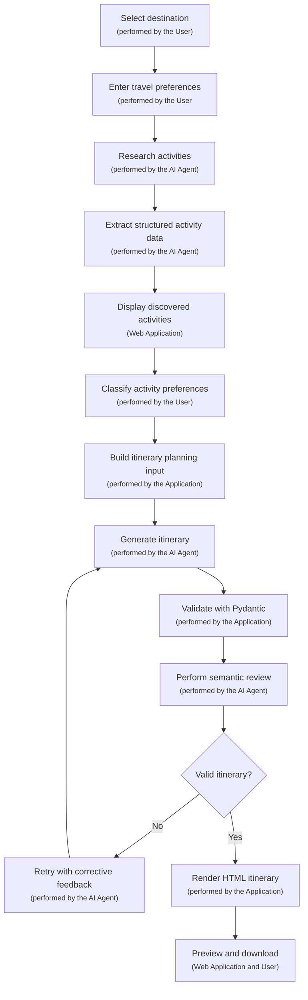

# AI Travel Planner

An AI-powered travel planning application that helps users discover activities at their destination, express their preferences, and generate personalized day-by-day itineraries.

The application combines web research, structured data extraction, user preferences, and language models to turn travel information into a practical travel plan.

🚀 **[Try the AI Travel Planner](https://huggingface.co/spaces/LuizaRMarnet/travel-planner)**

## Overview

Planning a trip involves more than finding interesting places. Activities need to match the traveler's interests, fit the available dates, and be organized into a realistic daily schedule.

This application addresses that process in two main stages:

1. **Activity discovery:** Research activities at the selected destination and present them for the user to evaluate.
2. **Itinerary generation:** Use the selected activities and travel preferences to generate a structured, time-based itinerary.

The application is built with Python, Gradio, Pydantic, and LangChain, using DeepSeek models and a web search tool.

## Features

### 1. Destination selection

- Search for destinations using location autocomplete.
- Retrieve geographically specific location results.
- Store the selected destination's coordinates and timezone.

Location search is powered by the [Open-Meteo Geocoding API](https://open-meteo.com/en/docs/geocoding-api).

### 2. Travel preferences

Users can provide information about their trip, including:

- Arrival and departure dates and times.
- Arrival and departure locations and transportation modes.
- Accommodation area or hotel information.
- Interests and places they want to visit.
- Activities and experiences they want to avoid.
- Number of meals per day.
- Preferred travel pace.
- Preferred transportation.
- Accessibility requirements.
- Additional travel notes.

These preferences are used during activity research and itinerary planning.

### 3. Activity discovery

The application researches tourist and leisure activities for the selected destination.

The research process uses:

- DeepSeek for language model interactions.
- A web search tool through `langchain-azure-ai`.
- Structured extraction with Pydantic.

Each activity can include:

- Name and description.
- Category and location.
- Estimated visit duration.
- Estimated price.
- Special notes.
- Source URL.

The research instructions emphasize source-grounded information and prohibit inventing missing details.

### 4. Activity preference collection

Users can classify each discovered activity using three preference levels:

| Preference | Priority |
|---|---|
| Absolutely! | Highest |
| Sounds good | Medium |
| Maybe | Lowest |

Users can also select **Not this time** to exclude an activity from itinerary generation.

Preferences are stored in the application session, and users can clear their classifications without repeating the activity search.

### 5. Personalized itinerary generation

The itinerary generator receives the selected activities and the user's trip information.

It aims to produce a detailed daily schedule containing:

- Individual activities.
- Meals and breaks.
- Free time.
- Transportation blocks when supported by the available information.
- Start and end times.
- Locations and descriptions.
- Relevant source and booking links when available.
- Estimated costs when supported by the input data.

The planning process prioritizes the user's activity preferences, travel pace, accessibility requirements, arrival and departure constraints, and other travel preferences.

The model is instructed to use only the supplied research information rather than inventing additional attractions or verified travel details.

### 6. Itinerary validation and review

Generated itineraries go through multiple validation stages:

1. JSON extraction from the model response.
2. Structural validation using Pydantic.
3. Local checks for dates, activity references, and itinerary consistency.
4. A separate semantic review using the language model.
5. Retry with corrective feedback when validation fails.

The application allows up to three generation attempts before reporting an error.

### 7. HTML itinerary export

The generated itinerary is rendered as a styled HTML document.

Users can:

- Preview the itinerary in the application.
- Download a standalone HTML file.
- Open the downloaded file in a browser.

---

## Application workflow



## Technology stack

| Technology | Purpose |
|---|---|
| Python | Main programming language |
| Gradio | Web application interface |
| Pydantic | Data models and validation |
| LangChain | Language model integration and structured output |
| DeepSeek | Activity research and itinerary generation |
| WebSearchTool | Web research |
| Open-Meteo | Destination geocoding |
| Requests | HTTP requests |
| HTML and CSS | Itinerary rendering and presentation |
| pytest | Automated testing |
| Ruff | Code quality and linting |

### Current Limitations & Ongoing Improvements

This project is an ongoing work in progress. Some limitations and areas for improvement are:

- **Desktop only:** The application is currently designed for desktop use and is not yet optimized for mobile devices.
- **Prompt refinement:** We are continuously improving the prompts to generate more relevant, accurate, and coherent activity suggestions and itineraries.
- **Budget-aware itinerary generation (planned):** The current itinerary generation process does not yet account for the user's budget. Incorporating budget constraints is a planned enhancement.
- **Ongoing testing:** Generated itineraries are still being tested and evaluated. Results may vary, and some suggestions may require manual review or adjustment.

Feedback and suggestions are welcome as the project continues to evolve.

## Project structure

```text
personalized-travel-planner/
│
├── src/
│   └── travel_agent/
│       ├── __init__.py
│       ├── main.py
│       ├── ui.py
│       ├── research.py
│       ├── itinerary.py
│       ├── itinerary_renderer.py
│       └── schemas.py
│
├── tests/
│   └── test_research.py
│
├── app.py
├── pyproject.toml
├── requirements.txt
├── uv.lock
├── .gitignore
├── .hfignore
└── README.md
```

### Main modules

- **`app.py`**: Application entry point used by Hugging Face Spaces.
- **`main.py`**: Loads environment variables, configures logging, and launches the Gradio application.
- **`ui.py`**: Builds the user interface and manages destination selection, preferences, activity discovery, and itinerary generation.
- **`research.py`**: Searches for activities and extracts structured information from web research.
- **`schemas.py`**: Defines Pydantic models for activities, preferences, and itinerary data.
- **`itinerary.py`**: Generates, validates, and reviews personalized itineraries.
- **`itinerary_renderer.py`**: Converts itinerary data into a styled HTML document.

---

## Getting started

### Requirements

- Python 3.11 or newer.
- [uv](https://docs.astral.sh/uv/).
- A DeepSeek API key.

### 1. Clone the repository

```bash
git clone https://github.com/luizamarnet/personalized-travel-planner.git
cd personalized-travel-planner
```

### 2. Install dependencies

Install the project dependencies and development tools:

```bash
uv sync --extra dev
```

### 3. Configure environment variables

Create a `.env` file in the project root:

```env
DEEPSEEK_API_KEY=your_deepseek_api_key
DEEPSEEK_MODEL=deepseek-flash
```

`DEEPSEEK_API_KEY` is required.

`DEEPSEEK_MODEL` is optional. If omitted, the application uses `deepseek-flash` as the default model.

Never commit your `.env` file or expose API keys in the repository.

### 4. Run the application

```bash
uv run python app.py
```

Gradio will launch the application and provide a local URL in the terminal.

---

## Running tests

The project uses pytest.

Run the test suite with:

```bash
uv run pytest
```

The existing test module is being aligned with the current `travel_agent` package structure and APIs.

## Deployment

The application is configured for deployment on [Hugging Face Spaces](https://huggingface.co/spaces).

The repository includes the Hugging Face configuration metadata in the README front matter and uses `app.py` as its application entry point.

For deployment:

1. Create a Gradio Space.
2. Upload or connect the project repository.
3. Configure the required environment variables in the Space settings.
4. Add `DEEPSEEK_API_KEY` as a Space Secret.
5. Allow the Space to build and launch the application.

Do not store API keys in source files or commit them to Git.

## Limitations and considerations

- Activity information depends on the available web research results.
- Missing prices, opening hours, addresses, and other details should be verified with the original provider.
- The itinerary generator does not perform routing or independent restaurant research during itinerary generation.
- Transportation durations and other unavailable details should not be treated as verified information.
- Generated itineraries should be reviewed before relying on them for bookings or time-sensitive arrangements.

## License

This project is licensed under the MIT License.